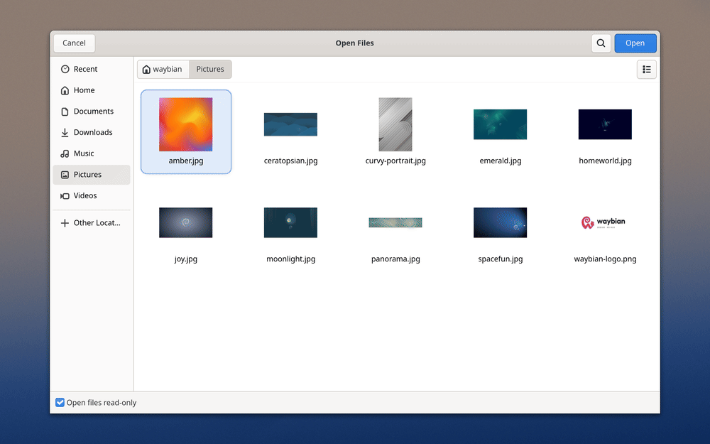
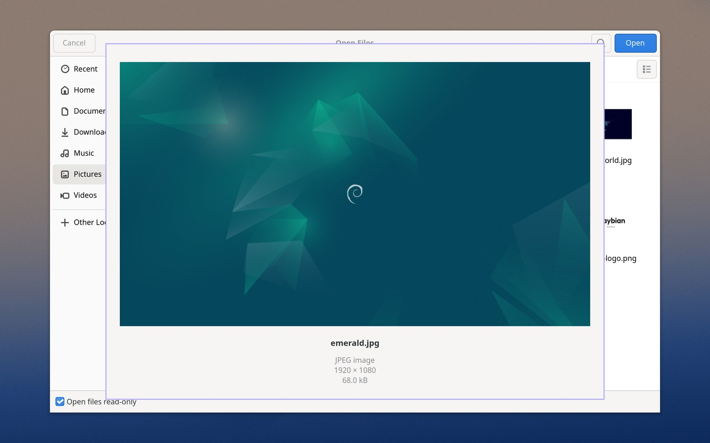
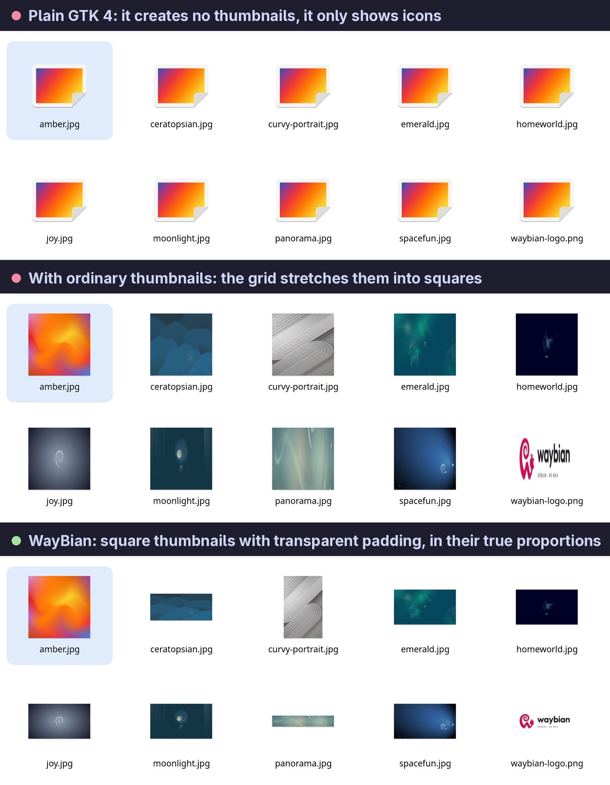

# xdg-desktop-portal-gtk4

This is a portal backend for [xdg-desktop-portal][portal] using GTK4.

If your Wayland compositor would otherwise use the [GTK3 portal][gtk3] (Sway, Jay,
Hyprland, etc.), you can instead use this portal to get thumbnails in the file picker.


[portal]: http://github.com/flatpak/xdg-desktop-portal
[gtk3]: http://github.com/flatpak/xdg-desktop-portal-gtk

## This fork: Quick Look in the open dialog

Branch [`waybian`](https://github.com/samucarre/xdg-desktop-portal-gtk4/tree/waybian) adds **Quick Look** to the open
dialog, like the one in the macOS Finder. With the focus in the file list:

- <kbd>Space</kbd> opens the selected file in its own window: an image fitted to the window (small images keep their
  size) or, for any other file, its type icon, with the name, type and size underneath (and the dimensions of images);
- the arrow keys move to the previous or next file while the window is open, and the selection in the dialog follows
  (with several files selected, they move through those only and the selection is kept);
- <kbd>Space</kbd> or <kbd>Esc</kbd> closes it, and the dialog's cursor is left on the file that was on screen, so
  <kbd>Enter</kbd> opens that one.

Space still types a space in the search and location entries. Save and folder dialogs are unchanged.

<p align="center">
  
</p>

How it works: GTK 4 removed the file chooser's preview widget, and GtkFileChooser has no selection signal, so
[`src/gui/quick_look.rs`](src/gui/quick_look.rs) puts a key controller on the dialog (capture phase) and, while the
preview is open, listens to the selection model of the dialog's file list. Files are decoded off the main thread
(`gio::spawn_blocking` + `gdk::Texture`); the size is read from the header first, so that a small file that expands to
gigabytes is decoded scaled down (above 40 megapixels) or not at all (above 100). The arrows use the list views' own
`list.select-item` and `list.scroll-to-item` actions. The window opens at 70 % × 80 % of the monitor and keeps that
size: a Wayland client cannot move its window, so a window that took the shape of each image would drift off centre
while moving through the files.

The commits on top of upstream (`2372e15`) live in this branch, which is built and used daily on WayBian (Debian and
Hyprland on a MacBook Pro M3 Max). To try it, build and install as below from this branch.

<p align="center">
  
</p>

### A note on thumbnails

The grid view only shows thumbnails that already exist in `~/.cache/thumbnails`; the file chooser does not create them
(on GNOME, Nautilus does when it visits a folder). GTK uses the largest size available, and the grid stretches every
thumbnail into a square, which distorts landscape and portrait images. On WayBian a small user service creates the
thumbnails ahead of time with `glycin-thumbnailer` and stores them square, with transparent padding:

<p align="center">
  
</p>

## Building & Installing

To build and install the portal, run

```bash
cargo build --release
meson setup build -Dprefix=/usr
sudo meson install -C build
```

## Configuring your Compositor

To make your compositor use the portal, you have to modify its configuration file in

- `/usr/share/xdg-desktop-portal/`

Add

```ini
org.freedesktop.impl.portal.FileChooser=gtk4
```

at the end to explicitly request the GTK4 portal for the file picker.

For example

```diff
--- jay-portals.conf.old    2024-09-20 14:55:49.029327860 +0200
+++ jay-portals.conf        2024-09-20 14:55:54.699731749 +0200
@@ -1,5 +1,6 @@
 [preferred]
 default=gtk
 org.freedesktop.impl.portal.ScreenCast=jay
 org.freedesktop.impl.portal.RemoteDesktop=jay
 org.freedesktop.impl.portal.Idle=none
+org.freedesktop.impl.portal.FileChooser=gtk4
```

Restart `xdg-desktop-portal` afterwards to apply the configuration:

```bash
systemctl --user restart xdg-desktop-portal
```

## License

xdg-desktop-portal-gtk4 is free software licensed under the GNU Lesser General Public
License v2.1.
